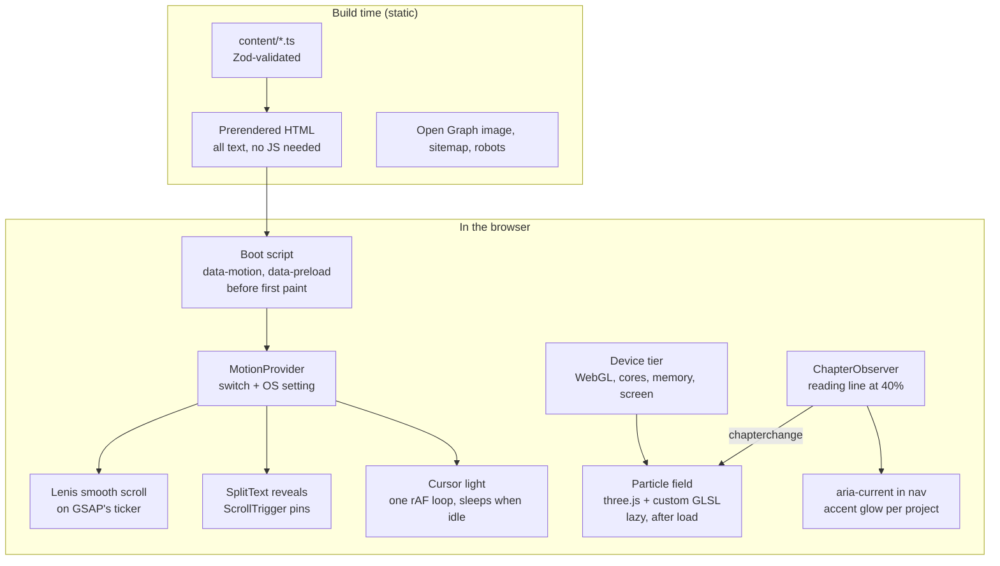

  

### [sarthxen.vercel.app →](https://sarthxen.vercel.app)

A portfolio told as one training session: warm-up, two sets, progressive overload, cool-down. 
One particle field changes shape with every chapter, and your cursor is the only light on the page.

[The story](#the-story) · [Measured](#measured) · [How it works](#how-it-works) · [Decisions](#decisions) · [Run it](#run-it) · [Quality](#quality)

## The story

| Chapter | What it says | The particles become |
|:--|:--|:--|
| **00 Warm-up** | Who I am, in one line | A sphere wrapped around the halftone portrait |
| **01 The grind** | 500+ DSA problems, an internship, a hackathon | A receding lattice |
| **02 Set 1: RideShare** | Real-time ride-hailing: races, payments, live location | The streets of a small city, with traffic pulses |
| **03 Set 2: CareNexus** | A triage assistant, and the bug that taught me to measure | A standing human figure |
| **04 Progressive overload** | What goes on the bar next | A field drifting upward |
| **05 Cool-down** | Say hi | The same field, settling |

Colour appears only inside the two case studies; the rest of the site is monochrome.

## Measured

Every number is produced by the [README assets workflow](.github/workflows/readme-assets.yml) from real runs (Vitest, Playwright on Chromium, Firefox and WebKit, Lighthouse mobile, a probe of the live site) and redrawn weekly. None is typed by hand.

## How it works

- **Static first.** Every word is in the prerendered HTML. Motion libraries and three.js load on demand after the page is interactive; with JavaScript off the site still reads end to end.
- **One light source.** A single pointer listener and requestAnimationFrame loop write two CSS variables. CSS uses them for the glow, a dot-grid reveal, a 1px card-border light (one fixed-attachment gradient masked with `mask-composite`) and heading text light. The loop stops when the light has caught up.
- **One particle field.** Each point has five positions (sphere, grid, roads, body, field), generated once from a seed. The vertex shader blends them from a single eased `uMorph` value; simplex noise draws the sphere's contour bands, and pulses travel along the road coordinates.
- **Respectful by default.** A `Motion` switch (remembered, synced across tabs) and `prefers-reduced-motion` turn off smooth scroll, reveals, the cursor light and particle animation. Phones get no 3D at all.

## Decisions

| Decision | Chose | Rejected | Why |
|:--|:--|:--|:--|
| Where the 3D lives | One fixed canvas behind the page | A canvas per section | One WebGL context, one draw call, shapes can morph into each other |
| Loading GSAP and three.js | Dynamic import after hydration / after `load` | Static imports | Lighthouse mobile went from 72–80 to 90–93; first-bundle JS no longer includes either |
| Hero headline reveal | Pure CSS keyframes | SplitText | The LCP element must not wait for JavaScript |
| 3D on phones | None | A lighter budget | ~800 ms of blocking time on mobile for a background effect is not worth a phone's battery |
| Numbers on the page | A schema that requires a source and date for every stat | Free-form copy | The build fails on an unsourced or unlabelled number |
| Smooth scroll | Lenis driven by GSAP's ticker | CSS `scroll-behavior` or Lenis's own loop | ScrollTrigger must read the smoothed position, or pinned sections drift |

## Run it

Requires **Node.js 22+**.

| Platform | Start |
|:--|:--|
| Windows | double-click **`start.cmd`** (installs dependencies when they change, starts the site, opens your browser) |
| Anywhere | `npm install && npm run dev` → http://localhost:3000 |

`start.ps1 -Prod` runs the production build instead; `-Port 3001` picks another port.

## Quality

| Check | Tool | Where |
|:--|:--|:--|
| Unit tests: schema rules, colour contrast, smoothing maths, morph shapes, motion preference, preloader timing | Vitest + Testing Library | every push |
| End-to-end on the production build: navigation, cursor light, smooth scroll, pinned tracks, MOTION OFF, no-JS, phones never download three.js | Playwright on Chromium, Firefox and WebKit | every push |
| Accessibility: no serious or critical WCAG 2.1 AA violations, motion on and off | axe-core | every push |
| Lighthouse mobile ×3: accessibility 100, best practices and SEO ≥ 95, CLS < 0.1 (build fails otherwise); performance and LCP tracked | Lighthouse CI | every push |
| Dependency audit of shipped packages | `npm audit` | every push |

Design document and version history: [`docs/`](docs).

Built with Next.js 16, React 19, TypeScript, Tailwind CSS 4, GSAP, Lenis, three.js and React Three Fiber. Fonts: Geist, Geist Mono and Instrument Serif (SIL OFL).
